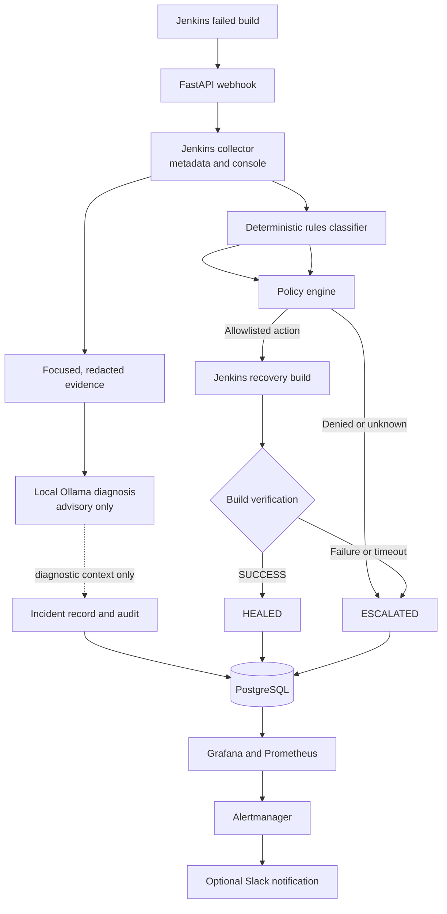

# AutoHeal — Policy-Gated Jenkins Recovery Prototype

AutoHeal is a portfolio prototype for analyzing failed Jenkins builds and attempting a narrowly allowlisted recovery. It is **not a production-ready autonomous repair system**.

## Design



**Safety boundary:** deterministic rules decide the internal failure category. Ollama supplies diagnostic context only. The policy engine receives the deterministic category/action and controls whether recovery is allowed. AI output cannot authorize an action or change the category used for policy.

## Current supported behavior

| Category | Policy | Important boundary |
|---|---|---|
| `FLAKY_TEST` | One controlled retry | Only an explicit test marker is treated as flaky in this prototype |
| `NETWORK_FAILURE` | One bounded connectivity recovery build | Only connection-level errors; generic HTTP 5xx responses are not classified as network failures |
| `WORKSPACE_FAILURE` | Clean workspace and retry | Jenkins shared library performs the workspace cleanup |
| `DEPENDENCY_FAILURE` | Recreate environment from existing manifest and retry | Does not change dependency versions or lockfiles |
| `DOCKER_FAILURE` | Cache-bypass rebuild and retry | Does not restart the Docker daemon or prune cache used by unrelated jobs |
| `REGISTRY_FAILURE` | One retry | Authentication failures are escalated, not retried blindly |
| `CODE_FAILURE` | Deny automatic remediation | Application/test code is never changed automatically |
| `UNKNOWN` and unsafe infrastructure conditions | Escalate | Human investigation required |

The policy permits at most one recovery build per incident. A separate in-memory circuit breaker limits repeated recoveries per job/category within a 30-minute window. The circuit breaker is intentionally simple and is not distributed or persistent.

## Requirements

- Docker Engine and Docker Compose v2
- Python 3.12 for local tests
- A Jenkins controller reachable from the AutoHeal container
- Jenkins API user/token with permission to read build/console data and trigger a build
- A Jenkins secret credential named `autoheal-webhook-secret` matching `WEBHOOK_SECRET`
- A local Ollama model only if AI diagnostics are desired

## Quick start

1. Copy `.env.example` to `.env`.
2. Replace the example Jenkins, database, webhook, Alertmanager and Grafana credentials. Keep the password in `DATABASE_URL` consistent with `POSTGRES_PASSWORD`; the example uses `${POSTGRES_PASSWORD}` interpolation.
3. Set `JENKINS_URL`, `JENKINS_USERNAME`, and `JENKINS_API_TOKEN` for your controller. `host.docker.internal` is configured for Docker Desktop/Linux Docker with `host-gateway`; change it if your environment differs.
4. Start the stack:

   ```bash
   docker compose up --build -d
   ```

5. Pull the model into the Ollama container (the model is **not** automatically downloaded by Compose):

   ```bash
   docker exec autoheal-ollama ollama pull llama3.2:3b
   docker exec autoheal-ollama ollama list
   ```

6. Check service health and dashboards:
   - API health: `http://localhost:8000/health`
   - Grafana: `http://localhost:3000`
   - Prometheus: `http://localhost:9090`
   - Alertmanager: `http://localhost:9093`

Compose runs Ollama on CPU by default so it starts on hosts without NVIDIA Container Toolkit. If NVIDIA Container Toolkit is installed and configured, opt into GPU support with:

```bash
docker compose -f docker-compose.yml -f docker-compose.gpu.yml up --build -d
```

The GPU override is optional and is expected to fail on hosts without a working NVIDIA container runtime.

## Local validation

```bash
python -m venv .venv
source .venv/bin/activate
python -m pip install -r requirements-dev.txt
python -m compileall -q app tests
ruff check app tests
pytest -q --cov=app --cov-report=term-missing
```

The tests use an isolated SQLite database and mock external Jenkins/Ollama interactions. They do not prove a live Jenkins controller, Docker daemon, registry, SonarQube server, or Slack webhook works end to end.

## Jenkins integration

The AutoHeal Jenkins Shared Library lives in `jenkins-shared-library/vars/autoheal.groovy`. Configure this repository as the Jenkins global library named `AutoHeal`. The Calculator demo also references the separate generic library named `Shared`, from:

- <https://github.com/Anantch2005/jenkins-shared-library>

That generic library is an external dependency and is not vendored into this repository. Its `docker_build` implementation currently performs a normal cached build and does not expose a cache-bypass option. To keep the library unchanged, the Calculator Jenkinsfile explicitly runs `docker build --no-cache` when the approved AutoHeal Docker recovery action is present. The `trivy_scan` implementation accepts an `exitCode` argument, which the pipeline sets to `1` for the CRITICAL/HIGH gate. The CI job in this repository does not execute those external Jenkins steps, so the live Jenkins path still needs a manual integration run.

The minimal example is `jenkins/AutoHealRemediation.example.groovy`. Recovery actions must call `autoheal(stage: 'checkout')`, `autoheal(stage: 'test')`, `autoheal(stage: 'docker')`, or `autoheal(stage: 'registry')` at the matching stage; calling `autoheal()` without a stage cannot apply a stage-bound action.

## Failure injection demo

The Calculator repository is a deliberately small demo target, not a production application. Its `AUTOHEAL_TEST_FAILURE` parameter can inject controlled failures. Two scenarios are designed to exercise actual recovery rather than relying on `AUTOHEAL_RETRY` to skip injection:

- `WORKSPACE_FAILURE`: creates a locked directory in the persistent workspace. The recovery build must clean the workspace before checkout.
- `DEPENDENCY_FAILURE`: removes `pytest` from the active virtual environment. The recovery action must recreate `.venv` and install from `requirements.txt` before the retry.

The Jenkinsfile records a one-shot demo marker after the approved recovery action. The marker prevents the demo fault from being re-injected on the recovery build; the environment repair itself is still required for the build to pass. A fresh manual build clears these demo markers. `FLAKY_TEST` is a one-shot synthetic failure injected by the pipeline, not a claim that statistical flakiness has been detected. `CODE_FAILURE` is intentionally denied and should not trigger a recovery build. `UNKNOWN_FAILURE` should escalate.

Run each scenario separately and retain the failed build, recovery build, AutoHeal incident, and Grafana result as evidence. Do not claim successful recovery until the recovery build is verified `SUCCESS`.

## Human alerts

Alertmanager authenticates to the API using a Bearer token rendered from `ALERTMANAGER_SECRET` in `.env`. The token is rendered at container startup; use an alphanumeric/hex token so shell substitution is safe. `SLACK_WEBHOOK_URL` is optional. If it is blank, AutoHeal logs alerts but does **not** deliver an external notification. Configure a Slack Incoming Webhook URL in `.env` to enable human notifications.

## Security notes

- Never commit `.env`, Jenkins tokens, database passwords, or Slack webhook URLs.
- The AutoHeal API and observability ports bind to `127.0.0.1` by default. Do not expose them publicly without adding an authenticated reverse proxy and appropriate network controls.
- Grafana credentials must be changed from the example values before use.
- The Calculator demo uses a Docker socket mount in its build agent; access to `docker.sock` is effectively privileged host access. Use a disposable agent, not a shared production controller.
- Trivy is configured to gate on `CRITICAL,HIGH` vulnerabilities in the demo pipeline. Scanner/database findings can change over time and must be reviewed rather than suppressed to force a green build.

## Known limitations / what broke during testing

- FastAPI `BackgroundTasks` is not durable. A process crash after accepting the webhook can lose the incident job.
- The circuit breaker is in memory and resets when the API process restarts. It is a simple local safety guard, not a distributed lock.
- The database compatibility migration adds `final_status` and a unique `(job_name, build_number)` index. If historical duplicates exist, the index creation is logged and must be resolved manually; rows are not deleted automatically.
- The integration tests mock Jenkins and remediation verification. A real Jenkins/Docker end-to-end run remains required before publishing claims about live recovery.
- Recovery actions are limited and environment-dependent. A cache-bypass build cannot fix a broken Docker daemon; connectivity checks cannot repair credentials; dependency recovery cannot fix a typo in an import; code failures are escalated.
- Alert delivery is only human-facing when `SLACK_WEBHOOK_URL` is configured and tested.
- The generic Jenkins `Shared` library is external; the project CI does not execute its Jenkins steps.

## Project CI

GitHub Actions runs Ruff, pytest with coverage, and a runtime Docker image build on pushes and pull requests. It does not run a live Jenkins controller or the full observability stack.

## License

MIT. See `LICENSE`.

